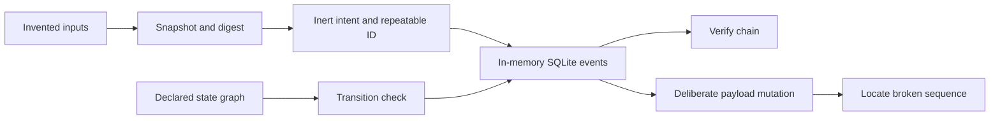

# Coinbase Pulse Trader — Engineering Showcase

A small, offline Python project demonstrating explicit state machines,
deterministic data serialization, and a tamper-evident SQLite event log.
Extracted from selected first-party components of a larger personal project,
with an independent history and wholly synthetic examples.

**Run locally. No runtime dependencies, credentials, network calls, or exchange
connection are required. This repository contains no trading implementation.**

## Run in under a minute

Requires Python 3.10 or newer, with the standard SQLite module. From this directory:

```bash
python3 -B -m pulse_trader.demo
python3 -B -m unittest discover -s tests -v
```

The demo prints a repeatable JSON report. It traverses a valid workflow,
refuses an undeclared transition, round-trips a snapshot and inert intent,
verifies six chained events, blocks ordinary updates/deletes, and then detects
an intentionally changed payload at sequence 3 in a disposable in-memory database.

## Engineering highlights

| Component | Demonstrated behavior |
| --- | --- |
| State machines | Eight enum-based transition graphs; explicit refusal of invalid or cross-machine edges; reachability checks |
| Snapshots | Typed data, exact-field deserialization, canonical JSON, and SHA-256 content digests |
| Intent identity | Repeatable UUID5 identifiers derived from synthetic lineage and attempt number; separate core and quote-envelope digests |
| Event log | Transaction-aware appends, contiguous sequence checks, chained SHA-256 hashes, and SQLite update/delete triggers |
| Indicators | Moving averages, return/volume windows, and volatility calculations over arithmetic synthetic candles |
| Tests | Synthetic checks for malformed input, rollback, serialization, graph behavior, and integrity failures |



Start with [the demo](pulse_trader/demo.py), then the
[architecture notes](docs/ARCHITECTURE.md) and [validation record](docs/VALIDATION.md).

## Optional installation

The commands above run directly from a checkout. For an isolated installed copy:

```bash
python3 -m venv .venv
.venv/bin/python -m pip install .
.venv/bin/pulse-showcase
```

An ordinary source install may obtain build tools. With `setuptools>=61` and
`wheel` already present in a build environment, the package can be built and
installed entirely offline:

```bash
python3 -m pip wheel --no-index --no-deps --no-build-isolation --wheel-dir dist .
.venv/bin/python -m pip install --no-index --no-deps dist/coinbase_pulse_trader_showcase-0.1.0-py3-none-any.whl
```

Use a separate environment: the retained import name is `pulse_trader`.

## Scope and limits

All example values are invented. No account, position, order, or market history
is included. There is no broker adapter, live scheduler, service installer,
dashboard, or authentication code. Names such as `EntryIntent` describe data
schemas only; the demo never decides or submits a trade.

Hash chaining detects inconsistencies relative to the stored chain. A privileged
writer can drop SQLite triggers and rewrite the entire chain or truncate its
tail. Detecting those actions requires a separately trusted head/count;
the tests demonstrate this limit. No external anchor is implemented here.

Frozen dataclasses are shallow: nested mappings can still change. Decimal text
is preserved rather than numerically normalized. Serialization checks are not
complete economic validation, and volatility calculations use floating-point
statistics internally. Determinism claims apply to identical inputs and the
tested Python environments, not all numerical platforms.

This showcase demonstrates software design and testing. It makes no claim of
profitability, production readiness, hardware security, or certification. It is
not affiliated with or endorsed by Coinbase.

## Attribution

Copyright (c) 2026 Mitchel34. See [ATTRIBUTION.md](ATTRIBUTION.md) for provenance
and dependency scope. No open-source license has been selected for this project.
